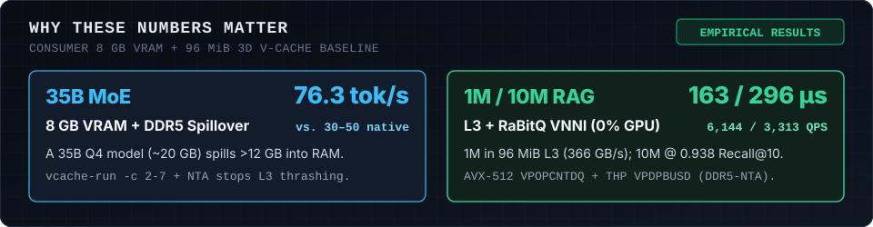
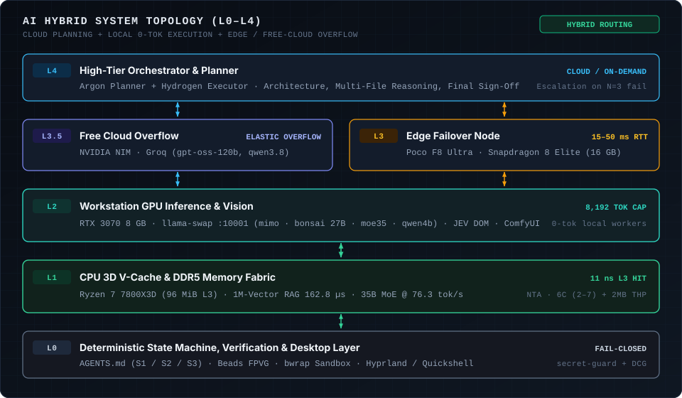

# AI Hybrid Systems, 3D V-Cache & Omarchy Linux

[](https://omarchy.org)
[-orange.svg)](#hardware--engineering-principles)
[](#public-repositories--benchmarks)
[](#public-repositories--benchmarks)

## TL;DR

Systems and local-AI engineering on **8 GB VRAM + AMD 3D V-Cache (96 MiB L3)** under **Omarchy Linux (Hyprland / Wayland)**. Everything here focuses on squeezing maximum throughput out of consumer hardware—pushing **35B MoE models to 89.5 tok/s**, running **1M-vector RAG inside CPU L3 in 163 µs**, scaling **10M-vector RAG to 296 µs (3,313 QPS)**, and building native Wayland/PipeWire/DKMS tooling with zero cloud lock-in.

<div align="center">
  
</div>

> [!IMPORTANT]
> **Local-first by default.** Consumer 8 GB GPUs hit a VRAM wall fast; pairing `llama.cpp` hot-expert caching with Ryzen 3D V-Cache core pinning (`vcache-run -c 2-7`) and non-temporal DDR5 prefetching (`GGML_MOE_NTA=1`) turns bandwidth-starved spillovers into smooth, interactive inference.

> [!TIP]
> **Target CPUs:** `zen-vcache-ai` AVX-512 kernels and L3 pinning are tested on **AMD Ryzen 7 7800X3D** (single-CCD 96 MiB L3 + AVX-512) and target Ryzen 9000X3D (on dual-CCD models, pin strictly to CCD0). The `llama.cpp` MoE patches and Omarchy plugins run on any modern x86_64 Linux box.

## Architecture // Hybrid AI Topology (L0–L4)

Hierarchical multi-tier routing topology balancing sub-millisecond L3 V-Cache retrieval, 8 GB CUDA inference, and edge/cloud overflow:

<div align="center">
  
</div>

## Public Repositories & Benchmarks

| Repository | Domain | Highlights & Measured Results |
| :--- | :--- | :--- |
| [**`zen-vcache-ai`**](https://github.com/simonezpx3/zen-vcache-ai) | Local AI / C / AVX-512 | **35B MoE @ `89.5 tok/s`** (`--moe-cache-cpu-share 0.8` + `vcache-run -c 2-7`); **1M-vector RAG in `162.8 µs`** (`6,144 QPS`, `366 GB/s`); **10M-vector RAG in `296.4 µs`** (`3,313 QPS`, `0.938` Recall@10); **1.2x–10.8x** code-editing speedup with `0 MiB` extra VRAM |
| [**`omarchy-qwenimage`**](https://github.com/simonezpx3/omarchy-qwenimage) | Generative AI / Python | **QIS** — local-first generative studio (Text-to-Image, Image-to-Image, Turbo diffusion, WD14 Danbooru interrogator, Qwen3-VL vision reverse-engineering, SIMD Lanczos resizer, ComfyUI backend) ([Omarchy Marketplace](https://omarchyplugins.com/plugin.html?id=simonez.qwenimage)) |
| [**`omarchy-bt-audio-eq`**](https://github.com/simonezpx3/omarchy-bt-audio-eq) | PipeWire / QML / Bash | Bluetooth codec & quality switcher (`LDAC`, `AAC`, `SBC-XQ`, `SBC`), PipeWire sample-rate selector, live telemetry, and 2-stage 10-band EQ with AutoEq ([Omarchy Marketplace](https://omarchyplugins.com/plugin.html?id=simonez.btquality)) |
| [**`omarchy-vkeyboard`**](https://github.com/simonezpx3/omarchy-vkeyboard) | Wayland / Quickshell | Non-focus-stealing OSK (`WlrLayer.Overlay`) with `wtype` injection, multi-language XKB switcher, and CRT Monolithic Grid styling ([Omarchy Marketplace](https://omarchyplugins.com/plugin.html?id=simonez.vkeyboard)) |
| [**`btusb-mt7902-dkms`**](https://github.com/simonezpx3/btusb-mt7902-dkms) | Linux Kernel / DKMS | Standalone DKMS driver patch & power fix for MediaTek MT7902 Bluetooth (`0489:e156`) on Arch / Omarchy kernels |

## Hardware & Engineering Principles

<details>
<summary><strong>Workstation Spec, Stack & Quickstart Commands</strong></summary>

| Component | Specification |
| :--- | :--- |
| **CPU** | AMD Ryzen 7 7800X3D (8C/16T, 96 MiB 3D V-Cache, AVX-512) |
| **GPU** | NVIDIA GeForce RTX 3070 8 GB |
| **Memory** | 32 GB Dual-Channel DDR5-6000 |
| **OS & WM** | Omarchy Linux (Arch-based) · Hyprland (Wayland) · Quickshell / Qt6 |
| **Languages** | C / C++, Python, Rust, QML / Qt6, Bash |

```bash
# Run 3D V-Cache MoE inference pinned to 6 cores (2-7)
GGML_MOE_NTA=1 ./bin/vcache-run -c 2-7 -- llama-server -m model.gguf -ngl 99 -cmoe --moe-cache-mib 4096 --moe-cache-cpu-share 0.8 -t 6

# Install Omarchy plugins directly
omarchy plugin add https://github.com/simonezpx3/omarchy-qwenimage.git --enable
omarchy plugin add https://github.com/simonezpx3/omarchy-bt-audio-eq.git --enable
omarchy plugin add https://github.com/simonezpx3/omarchy-vkeyboard.git --enable
```

</details>

---

**Support / Hardware Fund** *(RTX 3090 24 GB & Zen 5 X3D benchmarks)*: [Ko-fi](https://ko-fi.com/simonezpx3) · [Lightning (`arcicml@coinos.io`)](https://coinos.io/arcicml) · [Bitcoin](https://mempool.space/address/bc1qzt3djcdudxx93vjuusph4r5v9w08uca6zqkf85)
